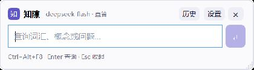

# 知隙 · Glance

随时打开一个轻量浮窗，看懂当前的词汇或概念，然后继续手边的事。

Windows 原生桌面知识查询助手。默认 DeepSeek、非思考、单轮、流式回答；个人记录保存在本机。待机仅 **420 × 116 DIP**，查询时展开为 **420 × 280 DIP**，清空后恢复输入栏。




截图使用本机模拟服务；测试环境使用了自定义快捷键。

## 下载与使用

前往 [Releases](https://github.com/Ark2000/glance-windows/releases/latest) 下载 **Glance.exe**，双击运行。面向 Windows 10/11 x64，自带 .NET 运行时，无需安装开发环境。首次启动会将运行时组件解压到用户临时目录。当前发行文件未作代码签名。

1. 打开「设置」，填写自己的 DeepSeek API Key，点击「保存并生效」。
2. **Ctrl + Alt + Space** 随时唤起浮窗，输入问题，按 **Enter** 查询。
3. 点击「停止」可中断生成；**Esc** 或右上角 × 收起浮窗并停止当前生成。
4. 托盘双击打开，右键可进入设置、历史或退出。
5. 点击「清空」开始新查询，并恢复紧凑输入栏；展开尺寸可手动调整。

如果快捷键被其他程序占用，状态栏会提示冲突，可在设置中更换，例如 `Ctrl+Shift+Q`。浮窗显示时可通过任务栏与 Alt+Tab 切换；收起后继续驻留托盘。

## 功能

| 场景 | 行为 |
| --- | --- |
| 快速查询 | 按需展开回答，首段即时安排显示，后续按约33毫秒合并刷新 |
| 回答方式 | 编辑回答指令、切换思考模式、选择模型 |
| 连接 | 软件内编辑 API Key、HTTPS 接口基础地址或完整 `/chat/completions` 地址 |
| 高级设置 | 最大输出 tokens、temperature、top_p、超时、附加 JSON 参数统一编辑 |
| 费用边界 | 单次、每日、每月限额；可编辑输入/输出单价 |
| 历史 | 后台读取与搜索、120毫秒搜索防抖、可见列表行复用、回顾、复用、逐条删除 |
| 导出 | 当前搜索结果导出为 UTF-8 Markdown 或 JSON |
| 本机保存 | Windows DPAPI 当前用户加密 Key；历史与费用账本独立保存 |
| 缩放 | 原生 WPF DIP 布局、Per-Monitor V2 DPI、窗口可调整尺寸，设置页可滚动 |

设置保存后立即用于后续请求。正在生成的请求使用发起时的设置快照。

网络解析、本机费用预留/结算、历史写入和导出在后台执行。显示文本使用有界缓冲，每批至多4096字符，长回答整理期间继续让出界面线程。历史窗口缓存已有记录，本程序新增或删除记录后重新读取；外部编辑文件后可点击「刷新」。

## DeepSeek 与兼容接口

默认地址 `https://api.deepseek.com`，默认模型 `deepseek-flash`，显式发送 `thinking: {"type":"disabled"}`。根据 [DeepSeek Chat Completions 文档](https://api-docs.deepseek.com/api/create-chat-completion/)，使用 SSE 与 `stream_options.include_usage` 读取内容及用量。支持最终内容段附带用量，也支持兼容接口的独立用量段。

默认输出上限 512 tokens，回答指令倾向于约150字的简短解释。回答为可选中复制的纯文本。自定义模型和接口须支持上述请求字段；若服务对参数有特定限制，请在高级设置中调整。仅允许 HTTPS；`localhost` 与回环地址支持 HTTP，供本机测试。HTTP 重定向已禁用，避免 Key 随重定向流转。

附加 JSON 可填写 `stop`、`response_format` 等模型支持的参数。模型、消息、流式、思考、采样与输出长度使用专用字段，工具调用、多回答及覆盖这些字段的附加参数会被拒绝。使用 JSON 输出时需在回答指令中同步要求 JSON。

## 费用规则

所有金额使用 **USD**。默认自定义单价为每百万输入 tokens **$0.30**、每百万输出 tokens **$1.20**，参考 2026-11-02 的 [DeepSeek Flash 高峰价格](https://api-docs.deepseek.com/quick_start/pricing/)，按输入缓存未命中估算。价格后续可能变化，切换模型或供应商后请更新单价。

默认限额：单次 **$0.02**、每日 **$0.50**、每月 **$5.00**。请求前按下面的金额预留，并检查三类限额：

```text
输入预留 tokens = 回答指令 UTF-8 字节数 + 问题 UTF-8 字节数 + 256
预留金额 = (输入预留 tokens × 输入单价 + 最大输出 tokens × 输出单价) / 1,000,000
```

- 收到服务用量回执后，按输入/输出 tokens 和本机设置单价结算。
- 停止、超时、断网、进程异常退出或缺少回执时，保留全额预留。
- HTTP 拒绝或发送前取消时释放预留；无自动重试，避免重复请求。
- 日/月边界按本机时间计算。清理历史后继续保留费用账本。
- 本机限额依据上述估算与所设单价执行。服务的分词、计价、额外收费或其他应用的请求会影响供应商账单，账单金额以供应商记录为准。

## 数据与隐私

默认目录：`%LOCALAPPDATA%\Glance`

```text
settings.json   通用设置与 DPAPI 加密 Key
history/        每条查询的独立 JSON（明文）
ledger.json     独立费用账本
```

软件无遥测、无自动更新。查询时，当前问题与回答指令发送到用户设置的服务；API Key 通过 Authorization 头发送。历史记录留在本机，手动导出时写到选定位置。Key 绑定当前 Windows 用户；迁移到其他账户后请重新填写。历史与导出内容为明文，请按需要保管。

本机 JSON 文件采用临时文件、刷盘、原子替换方式保存。读取到损坏文件时保留原文件并报错，便于备份和恢复。`GLANCE_DATA_DIR` 环境变量可覆盖数据目录，供隔离测试使用。该目录请始终指向本机位置。

## 开发与构建

要求 Windows 与 [.NET 10 SDK](https://dotnet.microsoft.com/download/dotnet/10.0)。使用 WPF + Windows 托盘 API，无第三方运行时依赖。

```powershell
dotnet build Glance.sln -c Release
dotnet run --project tests/Glance.Tests -c Release
dotnet run --project src/Glance.Desktop

# 测试并生成自带运行时的单文件 EXE
./scripts/publish.ps1
# 输出：dist/win-x64/Glance.exe
```

GitHub Actions 在 Windows 上测试并打包，产物含 EXE 与 SHA-256 校验文件。

维护者可手动运行「Publish Windows release」工作流，指定版本 tag，在 GitHub 构建并发布发行附件。

```text
src/Glance.Core/       SSE 客户端、设置校验、本机存储、预算账本、导出
src/Glance.Desktop/    WPF 浮窗、设置、历史、托盘、全局快捷键、DPAPI
tests/Glance.Tests/    无额外测试框架依赖的 Windows 测试程序
scripts/              发布脚本与本机模拟 API
```

### 本机模拟服务

无需 API Key 或付费调用，可验证界面与流式交互。测试数据与常规数据目录隔离。模拟服务固定返回一段关于熵的解释。

```powershell
python scripts/mock-api.py
# 在另一个终端中：
dotnet run --project tests/Glance.Tests -c Release -- --ui-fixture .local/ui-data
$env:GLANCE_DATA_DIR = Join-Path (Get-Location) '.local/ui-data'
dotnet run --project src/Glance.Desktop -c Release
```

17 项测试覆盖：SSE 中文逐字节传输、最终内容与用量、独立用量段、多行事件、错误/断流、取消、单轮请求字段、参数边界、DPAPI 加密与篡改检测、本机持久化、历史导出、并发预算限额、流式缓冲完整性与字符边界、历史读取取消、预算重启恢复、历史删除后的费用保留，以及真实窗口启动、紧凑/展开/清空布局、快捷键注册和100%/125%/150%/200%渲染检查。

桌面回归还会送入8000个密集流式片段，检查最终文本与输入计时器响应；用5000条记录检查可见行虚拟化及快速连续搜索。测试输出包含实测指标，具体延迟随设备与负载变化。真实 DeepSeek 调用需用户提供有效 Key。

## 许可

[MIT](LICENSE)
